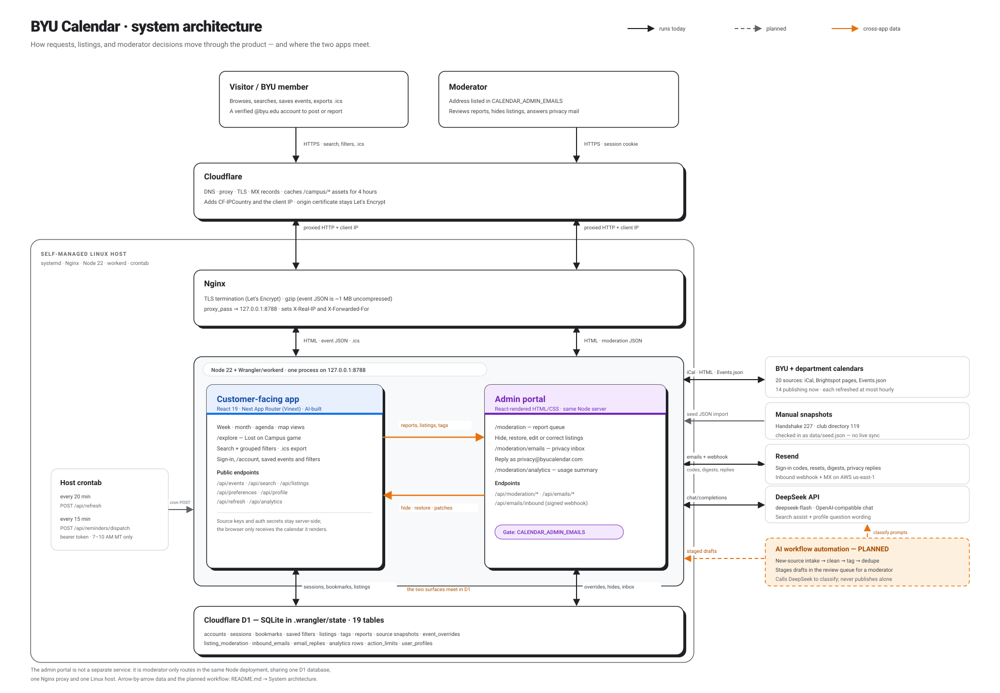
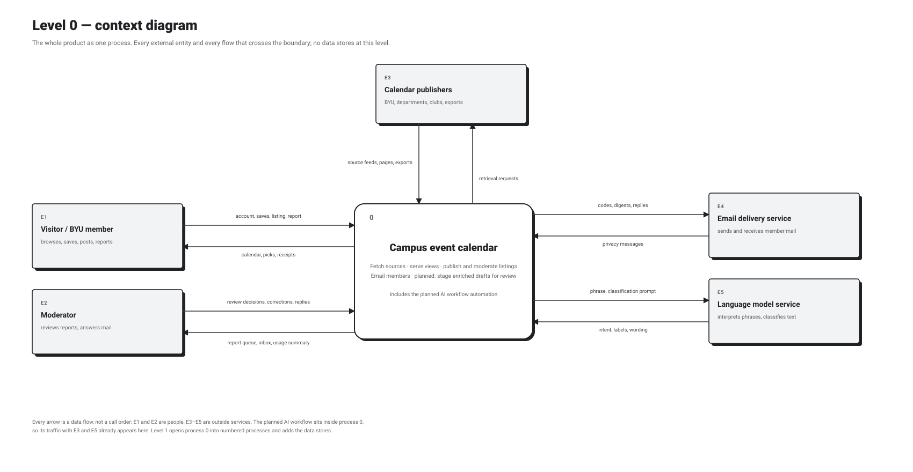
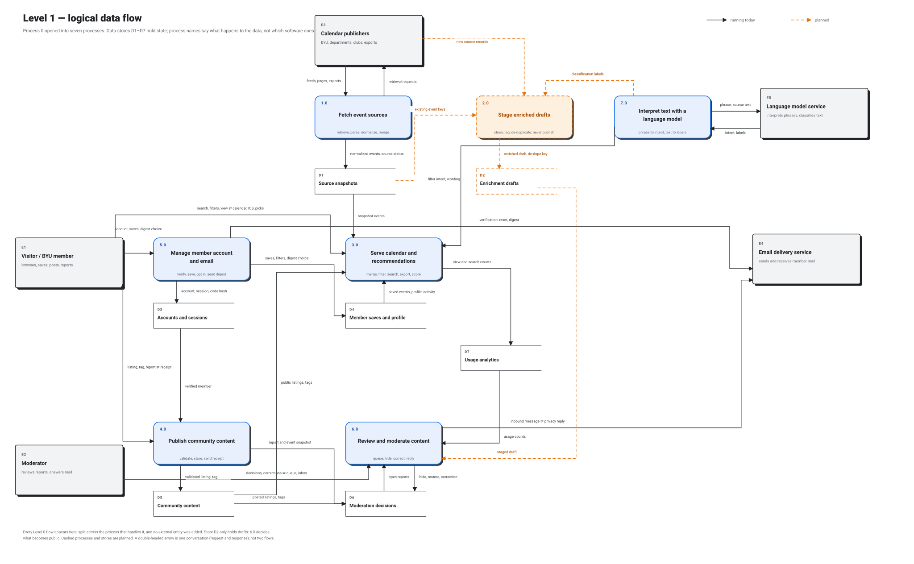
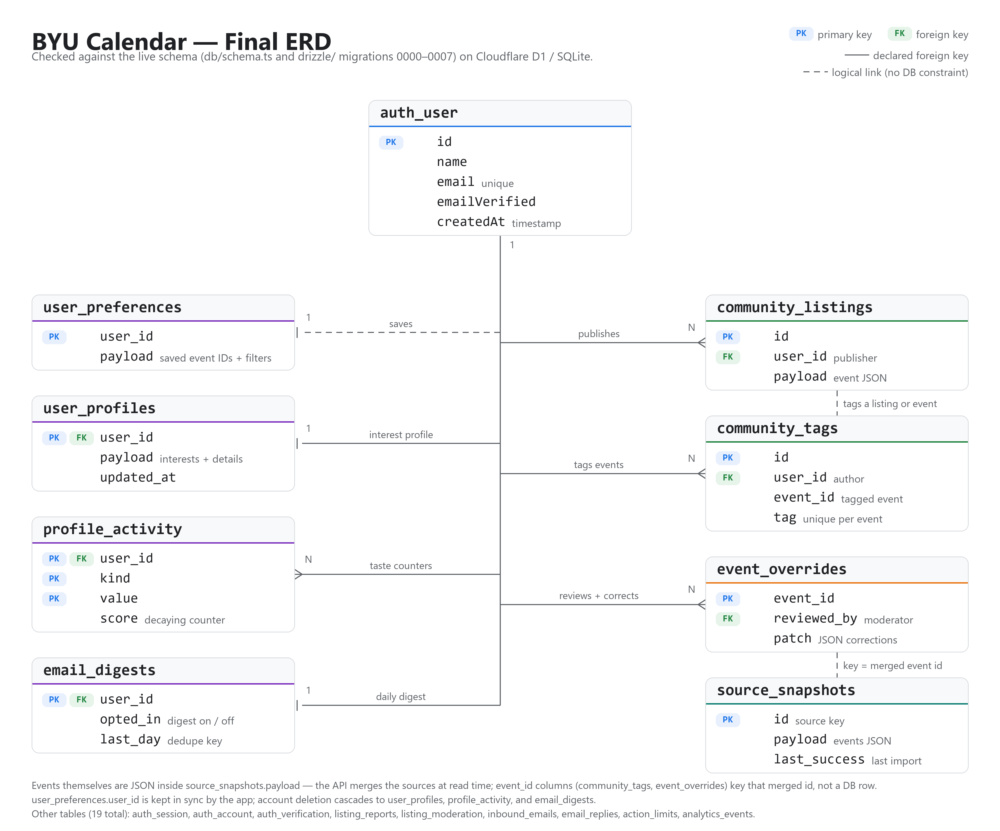

# BYU Calendar

A campus event calendar built with React, Vinext, and Cloudflare D1, using the colors and typography of CareerLaunchpad.

- Week, month, and responsive agenda views
- Public BYU, Marriott, AIS, Accounting Society, and department imports with source provenance
- A dated snapshot of 119 public listings from 48 student organizations
- A reviewed snapshot of 227 Handshake event listings, with organizer details and original links
- Phrase-based smart search and grouped interest/detail filters
- Account-specific saved events and named filters
- BYU email verification with immediate community listings/tags and private reports
- iCalendar export
- Personal picks: a chat-built interest profile with deterministic recommendations
- Persistent snapshots and automatic source refresh on visits and while open

See [maintenance and setup](docs/MAINTENANCE.md) for development, data sources, refresh behavior, and current limitations.

See [account setup](docs/ACCOUNTS.md) for permissions, database migrations, and email configuration.

## System architecture



Solid arrows are running at https://byucalendar.com; the dashed arrows are planned. The customer app and the admin portal are two route groups in one deployment: `/moderation`, `/moderation/emails`, and `/moderation/analytics` are served by the same Node process and proxy as the public calendar, gated only by `CALENDAR_ADMIN_EMAILS`, and both read and write the same D1 tables. There is no separate admin service or second database.

| From ⇄ To | Data that moves |
| --- | --- |
| Visitor ⇄ customer app (via Cloudflare and Nginx) | Search phrases, filters, view/date, save and RSVP actions, `.ics` requests. Back: HTML, event JSON (~1 MB), `.ics` files. |
| Moderator ⇄ admin portal (same path) | Requests carrying the Better Auth session cookie. Back: moderation HTML and JSON. |
| Cloudflare → Nginx → Node | Proxied HTTP/2 with `X-Forwarded-For`, `X-Real-IP`, and `CF-IPCountry`; Nginx adds gzip and forwards to `127.0.0.1:8788`. |
| Host crontab → Node | `POST /api/refresh` every 20 minutes; `POST /api/reminders/dispatch` every 15 minutes with a bearer token (sends 7–10 AM MT only). |
| Customer app ⇄ D1 | Sessions, bookmarks, saved filters, community listings, tags, reports, quota counters, analytics rows. |
| Admin portal ⇄ D1 | Report queue, `event_overrides`, `listing_moderation` snapshots, `inbound_emails`, `email_replies`. |
| Customer app → admin portal | Member reports, community listings, and tags that need review. |
| Admin portal → customer app | Hide/restore decisions and correction patches, applied at read time to public event JSON. |
| App ⇄ BYU and department sources | GET iCal feeds, Brightspot pages, and `Events.json` for 20 sources. Back: event records with times, venues, links, and retrieval status. |
| `data/seed.json` → app | Reviewed Handshake (227) and club-directory (119) snapshots; manual import only, no live sync. |
| App ⇄ Resend | Verification and reset codes, digests, privacy replies. Back: signed `email.received` webhook to `/api/emails/inbound`. |
| App ⇄ DeepSeek | Search phrase plus event vocabulary. Back: filter-intent JSON for optional smart search and profile question wording; the deterministic parser is the fallback. |

**Where the two apps connect.** The report a member files is a D1 row the moderator queue reads on its next request; the hide or correction a moderator saves is applied when `/api/events` renders for everyone else. Both flows are orange in the diagram. No queue, job, or second service sits between them.

**Planned.** AI workflow automation (dashed): intake for new sources, cleaning, tagging and de-duplication, and staged listing drafts for moderator review. It calls DeepSeek to classify and never publishes on its own. The current automation is the refresh and digest crontab.

## Data flow

Two data flow diagrams, drawn with the same notation: squares are external entities, rounded boxes are numbered processes, open rectangles are data stores (D1–D7). Solid is running today, dashed is planned. Both levels carry the same five external entities and the same boundary flows; Level 1 only opens process 0 and adds the stores.

**Level 0 — context.** The whole product as one process, with every flow that crosses its boundary and no data stores.



**Level 1 — logical.** Process 0 opened into seven verb-and-noun processes and seven data stores. Process 2.0 is the planned automation: it reads new source records, gets classification labels from 7.0, writes drafts to D2, and never publishes — 6.0 reviews drafts before anything reaches the public calendar.



| Store | Holds | Written by | Read by |
| --- | --- | --- | --- |
| D1 Source snapshots | Normalized events and source check status | 1.0 | 2.0, 3.0 |
| D2 Enrichment drafts *(planned)* | Cleaned, tagged, de-duplicated drafts | 2.0 | 6.0 |
| D3 Accounts and sessions | Verified accounts, sessions, code hashes | 5.0 | 4.0 |
| D4 Member saves and profile | Bookmarks, saved filters, digest choice, interests, activity | 5.0 | 3.0, 5.0 |
| D5 Community content | Published listings and tag notes | 4.0 | 3.0, 6.0 |
| D6 Moderation decisions | Reports, hides, correction patches, inbox replies | 4.0, 6.0 | 3.0, 6.0 |
| D7 Usage analytics | Aggregate view and search counts | 3.0 | 6.0 |

## Data model

The site runs on 19 tables in Cloudflare D1 (SQLite). The schema is defined in `db/schema.ts` and created by the migrations in `drizzle/`. Final ERD:



Sample rows from nine of the tables: [docs/sample-rows.png](docs/sample-rows.png).

## Local preview

Requires Node 22.13 or newer.

```powershell
git clone https://github.com/Canar8ue/BYUCalendarPublic.git
cd BYUCalendar
npm run install:ci                 # locked dependency install
node scripts/run-framework.mjs dev # dev app (read the actual preview port from the output)
```

The calendar loads with the checked-in seed data (`data/seed.json`); no environment configuration is needed to browse, search, filter, or export.

## Verification

`npm test`, `node node_modules/typescript/bin/tsc --noEmit`, `npm run build`, then `npm run test:worker`.

## Hosting

The calendar is self-hosted at https://byucalendar.com with Nginx, systemd, a local SQLite (Cloudflare D1) database, and a refresh cron every 20 minutes.
